

<picture>
  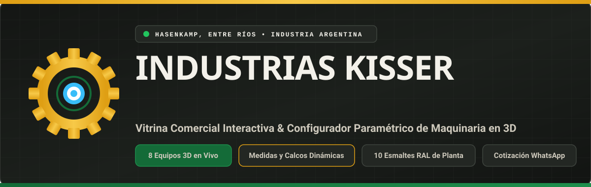
</picture>

 

<picture>
  
</picture>

## 🚜 Presentación del Proyecto

**Industrias Kisser** es una plataforma comercial interactiva y estudio de personalización en **3D en tiempo real**, diseñada para la fábrica metalúrgica de maquinarias agrícolas y viales fundada por **Don Carlos Kisser** en **Hasenkamp, Entre Ríos, Argentina**, y conducida hoy por sus hijos **Norby y Freddy Kisser**.

El objetivo central de la plataforma es **convertir visitantes en clientes reales mediante venta directa de fábrica**, permitiendo que cualquier productor agropecuario, contratista rural, comuna o municipio pueda:

1. **Explorar el escaparate comercial** con fotografías reales de equipos fabricados en planta.
2. **Dimensionar la capacidad o medida exacta** de la máquina (toneladas, cabezas de hacienda, cantidad de discos, litros o ancho de labor) viendo cómo la **estructura 3D y las calcos oficiales se modifican en vivo**.
3. **Pintar la máquina en 3 zonas independientes** (*Cuerpo General*, *Detalles / Chasis / Gráficas* y *Llantas / Discos*) con la paleta real de esmaltes poliuretánicos **RAL** de planta.
4. **Enviar el pedido configurado directo al WhatsApp de fábrica** con el resumen completo de medidas y colores elegidos.

> [!IMPORTANT]
> **Fidelidad Estructural Punto-a-Punto:** Cada uno de los 8 modelos 3D fue modelado matemáticamente a partir de las fotografías reales de planta en Hasenkamp, incluyendo el emblema oficial **`⚙ KISSER`** con su corona de 12 dientes en 360°, la inscripción **`INDUSTRIA ARGENTINA`** con escarapela sobre las lanzas y las gráficas dinámicas de capacidad.

<picture>
  
</picture>

## 🎨 Estudio 3D Paramétrico y Pintura en Vivo

  <picture>
    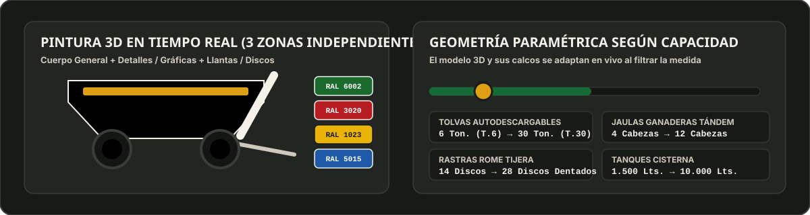
  </picture>

 

<picture>
  
</picture>

## 🛠️ Los 8 Equipos Configurables en 3D y Fotos Reales de Planta

<table width="100%">
  <tr>
    <td width="50%" valign="top">
      <h3 align="center">1. Tolva Autodescargable (T.6 a T.30)</h3>
      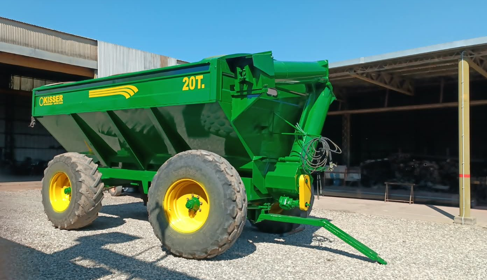
      

        <b>Rango dinámico 3D:</b> <code>6 Ton.</code> a <code>30 Ton.</code> 
        Adapta el largo del cajón piramidal, la cantidad de costillas inclinadas laterales, los arcos portacarpa superiores y actualiza en vivo las gráficas <b>T.6 ... T.30</b> y <b>6T. ... 30T.</b>
      

    </td>
    <td width="50%" valign="top">
      <h3 align="center">2. Acoplado Jaula Ganadera Tándem</h3>
      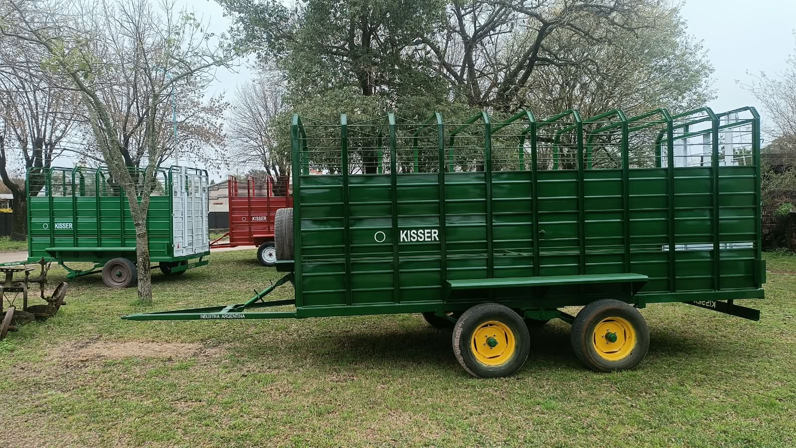
      

        <b>Rango dinámico 3D:</b> <code>4 Cabezas</code> a <code>12 Cabezas</code> 
        Recalcula el largo total de la jaula, el chasis tándem balancín, los 4 caños superiores de aireación y la cantidad de parantes verticales con ochava a 45° hacia adentro.
      

    </td>
  </tr>
  <tr>
    <td width="50%" valign="top">
      <h3 align="center">3. Pala Cargadora Frontal Hidráulica</h3>
      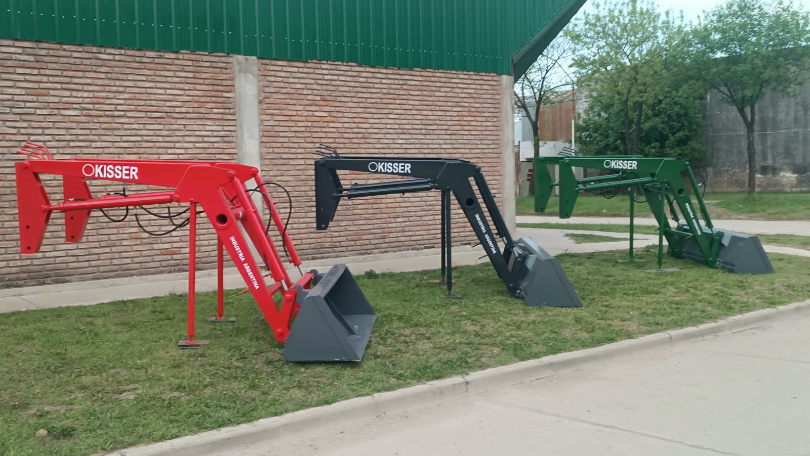
      

        <b>Rango dinámico 3D:</b> <code>1.000 kg</code> a <code>2.200 kg</code> 
        Brazos quebrados con paralelogramo mecánico, 4 cilindros hidráulicos de doble efecto conectados punto-a-punto y balde trapezoidal en cuña diagonal de ancho variable.
      

    </td>
    <td width="50%" valign="top">
      <h3 align="center">4. Rastra de Tiro Excéntrico Rome Tijera</h3>
      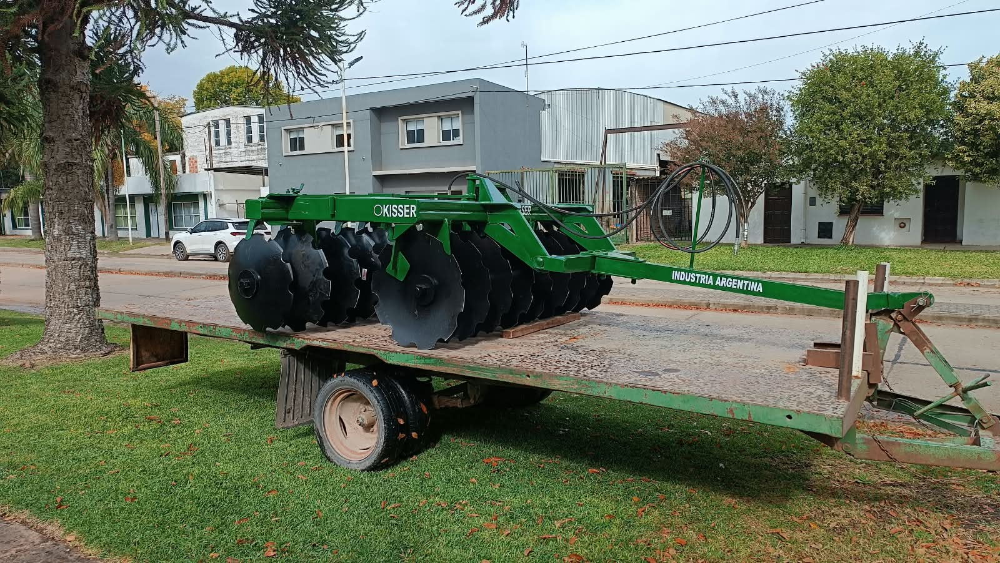
      

        <b>Rango dinámico 3D:</b> <code>14 Discos</code> a <code>28 Discos Dentados</code> 
        Modifica el ancho de los bastidores tubulares y agrega o quita discos cóncavos dentados de 26", carreteles separadores, limpiadiscos y bancadas en baño de aceite.
      

    </td>
  </tr>
  <tr>
    <td width="50%" valign="top">
      <h3 align="center">5. Acoplado Volcador Hidráulico Bilateral</h3>
      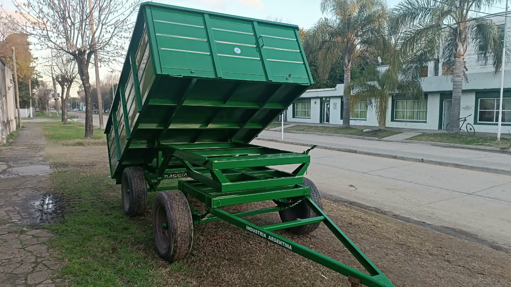
      

        <b>Rango dinámico 3D:</b> <code>4 Ton.</code> a <code>14 Ton.</code> 
        Chasis reforzado de 2 ejes con avantrén giratorio, cilindro telescópico central de 3 etapas debajo del piso y barandas laterales rebatibles con costillas dinámicas.
      

    </td>
    <td width="50%" valign="top">
      <h3 align="center">6. Pala Niveladora de Arrastre</h3>
      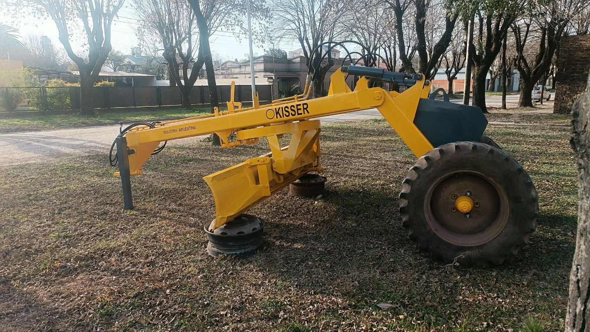
      

        <b>Rango dinámico 3D:</b> <code>240 cm</code> a <code>420 cm</code> de hoja 
        Viga espina central continua cuello de cisne, cajón de contrapeso trasero sobre eje de alta tracción y cuchilla curva regulable hidráulicamente.
      

    </td>
  </tr>
  <tr>
    <td width="50%" valign="top">
      <h3 align="center">7. Acoplado Tanque Cisterna / Combustible</h3>
      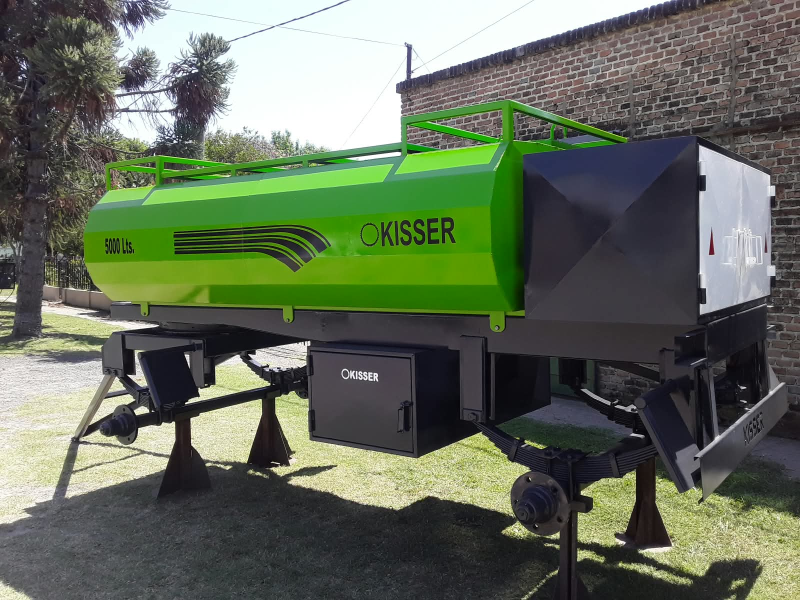
      

        <b>Rango dinámico 3D:</b> <code>1.500 Lts.</code> a <code>10.000 Lts.</code> 
        Tanque plegado octogonal con pasarela superior, baulera trasera con puertas blancas, cajones laterales y gráfica dinámica en vivo <b>1500 Lts. ... 10000 Lts.</b>
      

    </td>
    <td width="50%" valign="top">
      <h3 align="center">8. Trailer / Batea Tándem con Rampas</h3>
      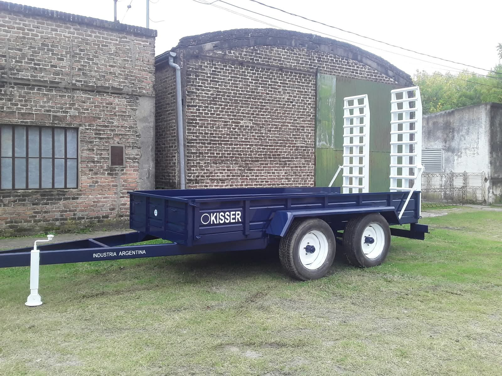
      

        <b>Rango dinámico 3D:</b> <code>4 Ton.</code> a <code>12 Ton.</code> 
        Plataforma de baja altura con guardabarros exteriores sobre tándem balancín y 2 rampas traseras rebatibles unidas mediante tensores estructurales.
      

    </td>
  </tr>
</table>

<picture>
  
</picture>

## 🔍 Detalles Técnicos por Equipo (Desplegables)

  
<b>🟢 Paleta Oficial de Esmaltes Poliuretánicos de Planta (Códigos RAL)</b>

   
  <table>
    <thead>
      <tr>
        <th>Color de Planta</th>
        <th>Código Industrial</th>
        <th>HEX</th>
        <th>Aplicación Habitual en Fábrica</th>
      </tr>
    </thead>
    <tbody>
      <tr>
        <td><b>Verde Kisser</b></td>
        <td><code>RAL 6002</code></td>
        <td><code>#1B6B2F</code></td>
        <td>Insignia histórico en jaulas, tolvas, rastras y cisternas</td>
      </tr>
      <tr>
        <td><b>Verde Inglés T.20</b></td>
        <td><code>RAL 6005</code></td>
        <td><code>#194528</code></td>
        <td>Línea pesada de Tolvas Autodescargables y Semilleras</td>
      </tr>
      <tr>
        <td><b>Rojo Carmesí Kisser</b></td>
        <td><code>RAL 3020</code></td>
        <td><code>#B81D24</code></td>
        <td>Palas cargadoras frontales, jaulas ganaderas y bateas</td>
      </tr>
      <tr>
        <td><b>Amarillo Vial / Llanta</b></td>
        <td><code>RAL 1023</code></td>
        <td><code>#EAB308</code></td>
        <td>Niveladoras de arrastre, volcadores viales, llantas y gráficas</td>
      </tr>
      <tr>
        <td><b>Azul Francia Kisser</b></td>
        <td><code>RAL 5015</code></td>
        <td><code>#1E5AA8</code></td>
        <td>Ediciones especiales de jaulas ganaderas y trailers batea</td>
      </tr>
      <tr>
        <td><b>Naranja Hacienda</b></td>
        <td><code>RAL 2008</code></td>
        <td><code>#D9531E</code></td>
        <td>Transportadores de rollos y combinaciones bicolores</td>
      </tr>
      <tr>
        <td><b>Gris Grafito / Pala</b></td>
        <td><code>RAL 7021</code></td>
        <td><code>#2B3036</code></td>
        <td>Baldes de pala frontal, contrapesos, bauleras y chasis</td>
      </tr>
      <tr>
        <td><b>Blanco Franjas / Guillotina</b></td>
        <td><code>RAL 9010</code></td>
        <td><code>#F4F4F0</code></td>
        <td>Pórtico trasero de jaula, arcos portacarpa y filetes laterales</td>
      </tr>
    </tbody>
  </table>

  
<b>⚙️ Fabricaciones Especiales y Desarrollos Metalúrgicos a Medida</b>

   
  

    Además de las 8 líneas seriadas configurables en 3D, la plataforma incluye un apartado de <b>Trabajos Especiales a Medida</b> con galería real de desarrollos propios:
  

  <ul>
    <li><b>Transportadores Hidráulicos de Rollos</b> en fila con cunas abatibles.</li>
    <li><b>Desmalezadoras de 3 Puntos, de Arrastre e Hileradoras</b> con cortina de cadenas protectoras.</li>
    <li><b>Módulos y Casillas Rurales</b> con aleros laterales rebatibles.</li>
    <li><b>Topadoras Frontales, Rastrillos de Desmonte y Tanques Industriales</b> con hidrogrúa propia.</li>
  </ul>

  
<b>🏭 Nuestra Planta y Local Comercial en Hasenkamp</b>

   
  <table width="100%">
    <tr>
      <td width="50%">
        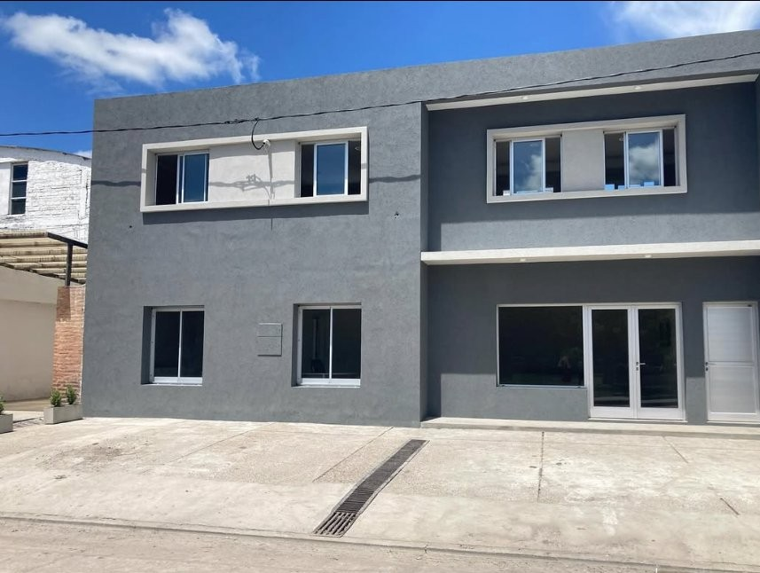
        
<b>Frente del Nuevo Local Comercial y Administración</b>

      </td>
      <td width="50%">
        
        
<b>Nave Metalúrgica en el Parque Industrial de Hasenkamp</b>

      </td>
    </tr>
  </table>

<picture>
  
</picture>

  

    <b>INDUSTRIAS KISSER — FÁBRICA DE MAQUINARIAS AGRÍCOLAS</b> 
    Parque Industrial Hasenkamp, Entre Ríos, Argentina • Tel: <code>0343 493-0083 / 15-4158502</code>
  

